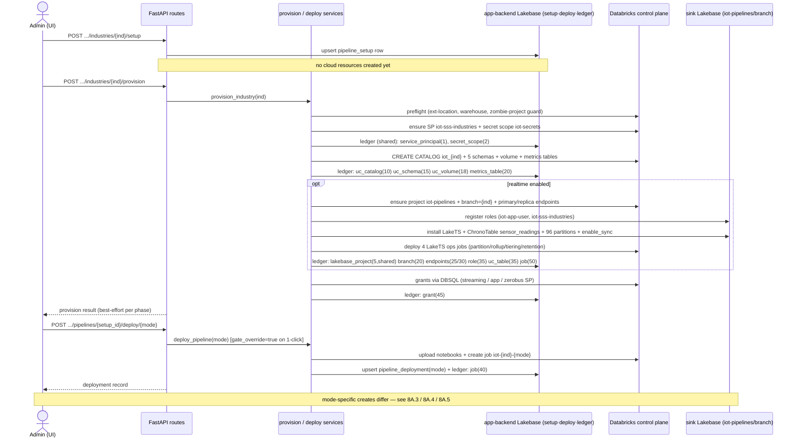
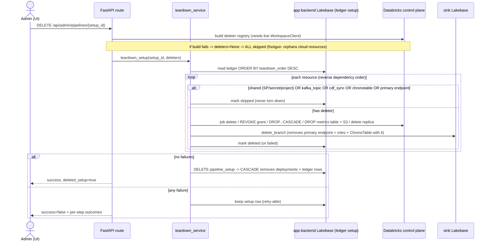
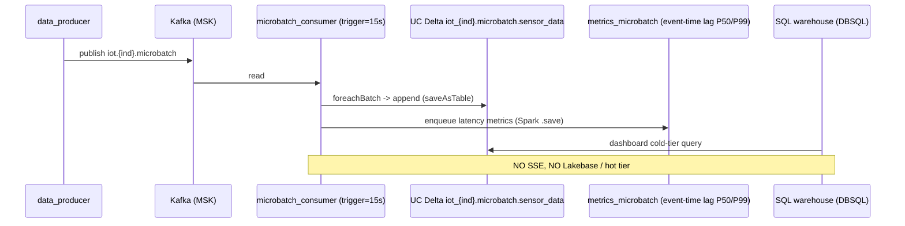
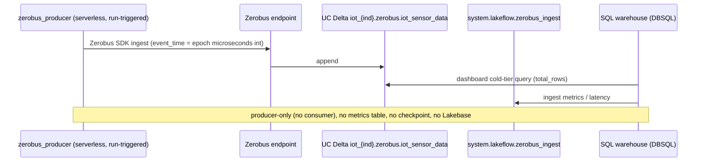
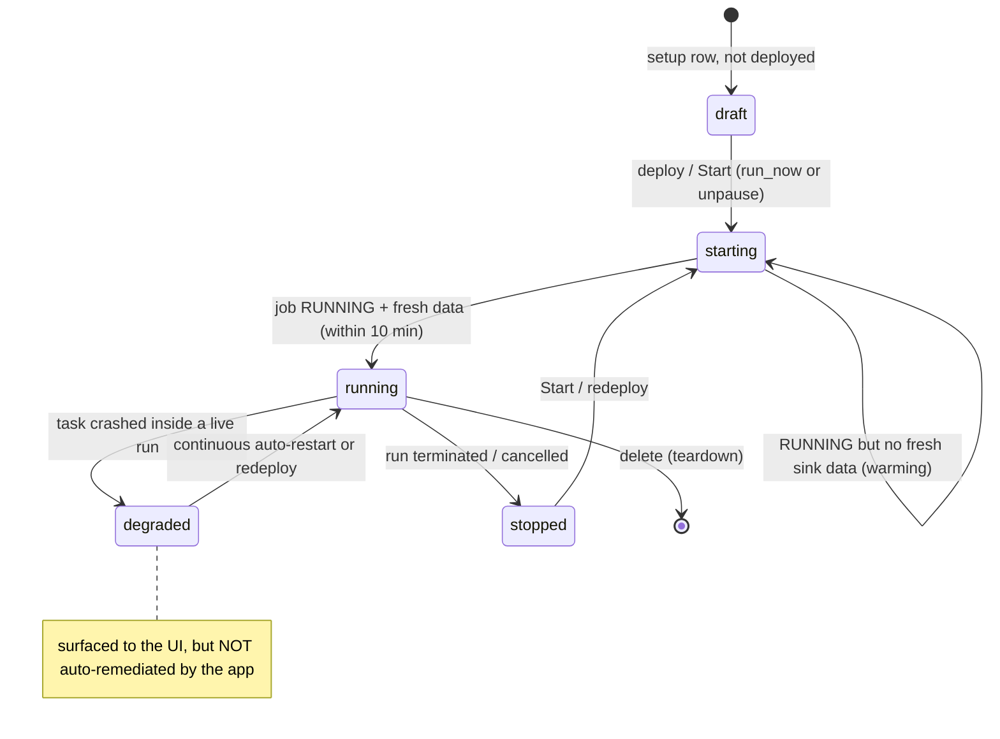

# IoT Digital Twin — End-to-End Behavior (As-Built)

> **Purpose.** A faithful, code-grounded description of what the app does *today* — every
> resource it creates, every data path, every backend it talks to — so we can walk through
> it function by function, decide what "correct" is, and fix it before redeploying to the
> new workspace (`fevm-classic-stable-realtime-demos`, id `7474659563748021`, region
> `eu-central-1`).
>
> Every claim is anchored to `file:line`. **`❓` callouts** mark places where I need *your*
> intended behavior (or where the code is ambiguous / half-finished / hardcoded to the old
> workspace). A consolidated question list is at the end (§11).
>
> Old workspace `fe-vm-shared-interop` (us-east-1) and all its assets were **torn down
> 2026-08-24** — so anything hardcoded to it is now dead.

---

## 1. Big picture

The app is a **FastAPI backend + React SPA** deployed as a Databricks App. It is
**industry-first**: pick an industry (thin-slice = `pharmaceutical`), then run one or more
**pipeline flavors/modes** against it. Each mode is a real Databricks deployment.

**Three pipeline modes**
| Mode | Path | Trigger | Sink |
|---|---|---|---|
| **realtime** | Kafka(MSK) → Spark RTM consumer → dual-write | `.trigger(realTime="5 minutes")` | Lakebase LakeTS ChronoTable **+** app SSE |
| **microbatch** | Kafka → Spark micro-batch | `.trigger(processingTime="15 seconds")` | UC Delta `microbatch.sensor_data` |
| **zerobus** | Zerobus SDK (no Spark) | direct ingest | UC Delta `zerobus.iot_sensor_data` |

**Three dashboard data tiers**
- **SSE (live):** realtime consumer POSTs each batch to `/api/sss/ingest`; app fans out over `/api/events`.
- **Lakebase (hot):** `sensor_readings` ChronoTable on a per-industry branch of the shared `iot-pipelines` project.
- **DBSQL (cold):** aged rows in UC Delta, queried via a SQL warehouse (realtime reaches Delta only via Lakebase CDF Sync-to-Delta).

**Four identities**
- **App SP** — injected at runtime as `DATABRICKS_CLIENT_ID`. Does UC work (SDK auth), owns the app-backend Lakebase connection (OAuth), and gets a per-branch Lakebase role `iot-app-user`.
- **Shared streaming SP** — `iot-sss-industries` (fallback app-id `9927a7fa-…`, `services/industry_catalog_service.py:66`). The realtime consumer authenticates to Lakebase as this; also granted on UC. Secret scope `iot-secrets`, keys `sss-industries-client-id/-secret`.
- **Zerobus SP** — `ZEROBUS_CLIENT_ID` (was `01329a59-…`). Secret `iot-secrets/zerobus-client-secret`.
- **Human user** — admin via forwarded token (§9).

**Two backend Lakebase connections** (metadata only, no sensor data) — see §2.

---

## 2. Backend persistence, config & boot

### 2.1 Two Lakebase connections
| | **Legacy** (`backend.py`) | **App-backend** (`services/app_backend_db.py`) |
|---|---|---|
| Class | `LakebaseConnectionManager` (`backend.py:49`) | `AppBackendConnectionManager` (`app_backend_db.py:43`) |
| Project | `iot-lakets-demo` | `iot-app-backend` (`:31`) |
| Endpoint env | `LAKEBASE_ENDPOINT` (`app.yaml:15`) | `APP_BACKEND_LAKEBASE_ENDPOINT` (`:32`) |
| Host env | `PGHOST` | `APP_BACKEND_PGHOST` (`:36`) |
| Host default | none in code; `app.yaml:10` = `ep-fancy-king-…` (**dead ws**) | **hardcoded in source** `ep-mute-scene-d2cvnr0v…` (`:38`, **dead ws**) |
| Auth | static (if `PGUSER`+`PGPASSWORD`) **or** SDK OAuth + 50-min refresh (`backend.py:84-90,111-135`) | **always** SDK OAuth (`:51-77`) — ignores injected static creds |

**Legacy tables** (created at boot, DDL-privilege-tolerant):
- `pipelines` (`backend.py:213-232`) — id, user_email, name, status, industry, sensor_config, source_type, source_config, sink_config, resources, timestamps.
- `user_settings` (`:245-250`) — user_email PK, settings JSONB, updated_at.
- `source_bindings` (`models/sql_ddl.py:57-74`) — source-claim ledger, partial-unique `uq_active_source (source_type, source_key) WHERE status='active'`, FK→pipelines CASCADE.

**App-backend tables** (`models/app_schema.py`):
- `pipeline_setup` (`:34-52`) — one row per industry; `industry UNIQUE`; holds flavor, source_type, bootstrap_servers, enabled_modes, cluster_spec, warehouse_id, `validation_state JSONB`, status, user_email.
- `pipeline_deployment` (`:54-75`) — one per (setup, mode); `mode CHECK in (realtime,microbatch,zerobus)`; `UNIQUE(setup_id, mode)`; job_id, notebook_path, delta_table, checkpoint_path, cdf_enabled, lakebase_branch/endpoints.
- `provisioned_resource` (`:77-92`) — teardown ledger; resource_type, identifier, parent_ref, `teardown_order`, status, metadata.

> **✅ Q1 — decided (2026-08-27): one project, one connection.** Provision a **single** Lakebase
> project (`iot-app-backend`) holding **all** app metadata, and **unify to one OAuth connection**
> (drop the dual `LakebaseConnectionManager` / `AppBackendConnectionManager` split — one pool, one
> env-driven endpoint).
> - Tables on the single project: `pipeline_setup`, `pipeline_deployment`, `provisioned_resource`,
>   **plus** the still-used `user_settings` and `source_bindings`.
> - **Retire the legacy per-pipeline UI**: `routes/pipelines.py` + the `/legacy` dashboard + the
>   `pipelines` table (verify nothing industry-first depends on it first). Keep `user_settings`
>   (app-global warehouse id via `dbsql_service`) and `source_bindings` (`source_registry`).
> - **Retire the demo-only loops** that only made sense when `iot-lakets-demo` doubled as a demo
>   sensor store: the matview-refresh loop and the 1-day `sensor_readings` retention purge
>   (`app.py:113-142`). Industry-first sensor data lives on the per-industry `iot-pipelines` branches.
> - Config: one endpoint env var; **drop** the `PGHOST`/`LAKEBASE_ENDPOINT` vs `APP_BACKEND_*`
>   duplication and the hardcoded `app_backend_db.py:38` default.

### 2.2 Boot sequence (`app.py` lifespan `:40-148`)
1. Legacy DB — only if `PGHOST` set; init + `ensure_*` tables. **Non-fatal** (logs, sets `db_available=False`).
2. App-backend DB — always attempted (own host constant); init + `ensure_app_schema`. **Non-fatal**.
3. Simulator task; matview-refresh loop + retention loop (only if `db_available`).

Neither DB failure crashes the app — status is recorded in `AppState` for truthful reporting. **No schema migrations** — only `CREATE TABLE IF NOT EXISTS`; adding a column to an existing table would silently not apply (`app_schema.py`, `backend.py`).

### 2.3 Workspace-hardcoded values that MUST change for redeploy
| Value | Where | Note |
|---|---|---|
| `PGHOST=ep-fancy-king-…` | `app.yaml:10` | dead ws host |
| `APP_BACKEND_PGHOST` default `ep-mute-scene-…` | **`app_backend_db.py:38` (source)** | worse — a code default, not just config |
| `LAKEBASE_ENDPOINT=projects/iot-lakets-demo/…` | `app.yaml:15` | dead project |
| `ZEROBUS_SERVER_ENDPOINT=332040261549026.zerobus…` | `app.yaml:22` | embeds old ws id |
| `ZEROBUS_CLIENT_ID=01329a59-…` | `app.yaml:26` | deleted SP |
| `DATABRICKS_HOST` fallback `e2-demo-field-eng…` | `simulator_service.py:94` | stale, wrong ws |
| `s3://taran-shared-interop` + ext-location `taran-shared-interop` | `industry_catalog_service.py:57-58` | **not env-driven**; provisioning pre-flight fails without it |
| MSK bootstrap `b-{1,2,3}-public.iotdemo…:9198` | `industry-deploy-config.ts:41-44` | old MSK |
| service credential `iot-rtm-sc` | `industry-deploy-config.ts:47` | UC service credential |
| Lakebase project `iot-pipelines` | `industry-deploy-config.ts:52`, `pipelines_project_service.py:38` | hardcoded name |
| secret scope `iot-secrets` | many (`provisioning_service.py:267`, `validation_steps.py:757`, …) | hardcoded default |
| fallback SP id `9927a7fa-…` | `industry_catalog_service.py:66` | old SP |

> **✅ Q2 — decided (2026-08-27): nothing hardcoded.** Every workspace-specific value moves to
> `app.yaml`/env behind a **config module** — no hosts, S3 bucket / external-location names, Lakebase
> project names, SP client-ids, MSK bootstrap servers, service-credential names, zerobus endpoint, or
> secret-scope names in source. This includes the `app_backend_db.py:38` host default,
> `industry_catalog_service.py:57-58` (`s3://taran-shared-interop` / `taran-shared-interop`), the
> `industry-deploy-config.ts` literals (MSK bootstrap, `iot-rtm-sc`, `iot-pipelines`), the
> `iot-secrets` scope defaults, the `9927a7fa…` fallback SP id, and `simulator_service.py:94`. A
> redeploy to any workspace becomes **config-only, no source edits**.

---

## 3. Setup & provisioning

Two entrypoints: **industry-first (primary)** `POST /api/admin/industries/{industry}/provision` → `industry_provisioning_service.provision_industry` (`services/industry_provisioning_service.py:46-176`); and a **legacy** `POST /api/setup/pipeline-lakebase`. The setup route `POST .../setup` only writes a `pipeline_setup` row — **no cloud resources** (`routes/industries_admin.py:265-332`).

**`provision_industry` order:** pre-flight → shared SP + secret scope → UC catalog/schemas/volume/metrics tables → (realtime only) Lakebase branch/endpoints/roles/LakeTS → grants. All phases best-effort except pre-flight.

### 3.1 Lakebase (streaming sink)
- **Project (SHARED):** `iot-pipelines`, created/reused idempotently, `metadata.shared=True`, **never torn down** (`pipelines_project_service.py:102-129,447-456`).
- **Branch (per-industry):** name == industry, never-expiring (`:215,233-237`), db `databricks_postgres`.
- **Endpoints:** `primary` READ_WRITE (resized to CU [0.5,4.0]) — streaming writes here; `replica` READ_ONLY (CU [0.5,2.0]) — dashboard reads here (~6s lag) (`:250-298,516-531`).
- **Two PG roles** (OAuth-native, `LAKEBASE_OAUTH_V1`, superuser): `iot-app-user` (app SP) and `iot-sss-industries` (streaming SP) (`provisioning_service.py:784-1096`).

### 3.2 Unity Catalog
- **Catalog:** `iot_<industry>` (`industry_catalog_service.py:84-93`), `storage_root = s3://taran-shared-interop/<catalog>` (metastore has no default root, `:96-98,220`).
- **Schemas:** `realtime, microbatch, zerobus, metrics, checkpoints` (`:61`).
- **Volume:** `stream_checkpoints` in `checkpoints`.
- **Tables created by provisioning:** only the **external metrics Delta tables** `metrics.streaming_metrics_realtime` & `…_microbatch` (external at `s3://taran-shared-interop/iot-digital-twin/<catalog>/metrics/…`). **Zerobus has no metrics table** (not a Spark stream). The sensor data tables (`microbatch.sensor_data`, `zerobus.iot_sensor_data`, realtime CDF shadow) are created by the **deploy/producer path**, not here.

> **✅ Decided (2026-08-27): one catalog, one schema, industry-prefixed tables.** The new workspace
> uses a **single** UC catalog + schema for *all* modes and industries (replaces the per-industry
> catalog × 5-schema sprawl):
> - **Catalog:** `classic_stable_realtime_demos_catalog` · **Schema:** `rtm_lakets_zb` — both **config,
>   not hardcoded** (§2.3).
> - **Tables (industry-prefixed, all in the one schema):** `{industry}_realtime` (CDF-synced cold
>   history), `{industry}_microbatch`, `{industry}_zerobus`, and **`{industry}_metrics`** (managed,
>   with a `mode` column); plus the checkpoints **volume** `checkpoints` (subpaths `{industry}/{mode}`).
> - **Streaming metrics via Zerobus (decided 2026-08-27).** Drop the external-S3 + Spark
>   `.save(location)` + delta-rs path. The **realtime & microbatch** consumers push each metrics record
>   through the **Zerobus SDK** into the managed `{industry}_metrics` table (`mode` column; timestamp as
>   **epoch-µs int**). Provisioning **pre-creates** the table + grants the **Zerobus SP** write.
>   Dashboard **tiles and charts** both read this one table — which **fixes the empty-charts bug** — and
>   the raw-progress STRING blob is dropped. Zerobus *mode* ingest metrics still come from
>   `system.lakeflow.zerobus_ingest`.
> - The Lakebase shadow / ChronoTable is **named per-industry** so the CDF-config API materializes a
>   uniquely-named table into the shared schema (it mirrors the Postgres table name).
> - **Grants collapse** to the single catalog + schema. Provisioning creates **1 catalog + 1 schema +
>   1 volume** instead of a catalog and five schemas per industry.

### 3.3 Secrets / SPs / grants
- Shared streaming SP `iot-sss-industries` ensured (find-or-create + OAuth secret + `CAN_USE` on app + Lakebase role); secret scope `iot-secrets`. Both flagged shared (never torn down).
- Zerobus SP referenced from `ZEROBUS_CLIENT_ID` (grant skipped if unset). App-backend SP = `DATABRICKS_CLIENT_ID`.
- **Grants** (via DBSQL, recorded as ledger `grant` rows): streaming SP gets USE CATALOG + USE/MODIFY/SELECT on realtime/microbatch/metrics + EXTERNAL USE SCHEMA on metrics + CREATE TABLE on zerobus; app SP gets SELECT on catalog (cascades to CDF history) + metrics write; zerobus SP gets USE CATALOG + zerobus-schema privileges.

### 3.4 LakeTS
`sensor_readings` ChronoTable created on the branch (`industry_setup_service.py:61-154`): install LakeTS from `LAKETS_SQL_PATH` → create table (`id BIGINT` seq + 11 canonical `SensorRecord` cols + `source TEXT DEFAULT 'sss'`, time col `event_time`) → register ChronoTable (15-min chunks) → pre-create **96** future partitions (~24h) → `enable_sync` (creates `lakets_cdf._shadow_sensor_readings` + trigger for later managed CDF sync).

**LakeTS ops jobs** (4 serverless notebook jobs, targeting the branch `primary`):
| Job | Cron (UTC) |
|---|---|
| Partition Manager (`p_future_count:=192`=48h) | `0 0 2 * * ?` daily 02:00 |
| Rollup Refresh | every 15 min |
| Tiering | every 30 min |
| Retention | daily 03:00 |

> **❓ Q3.** Docstrings/comments say the partition manager runs "every 10 minutes" but the cron is **daily 02:00** (`lakets_deploy_service.py:401` vs `:675-686`). Functionally fine (48h window), but confirm the intended cadence so I fix the code or the comments. Also: partition pre-create is **96 (24h)** at provision but the ongoing manager uses **192 (48h)** — intended, or align?

### 3.5 Teardown ledger
Rows recorded with `teardown_order` (reverse-order teardown, §8). Shared rows (`service_principal` iot-sss-industries=1, `secret_scope` iot-secrets=2, `lakebase_project` iot-pipelines=5) are recorded but **skipped** on teardown. Per-industry rows: uc_catalog(10), uc_schema(15), uc_volume(18), lakebase_branch(20), metrics_table(20), endpoints(25/30), chronotable+role(35), grant(45), job(50).

> **❓ Q4.** `enable_realtime=false` industries get UC + grants but **no Lakebase/LakeTS sink** (`industry_provisioning_service.py:106`). So "provisioned" ≠ "has a hot tier". Is that the intended contract, or should microbatch/zerobus-only industries also get something on the hot tier?

---

## 4. Validation (Tier-2 interactive e2e)

`routes/validation_admin.py` → `services/validation_service.py` (+ state machine + steps). Persists state to `pipeline_setup.validation_state` before/after **every** step (crash-resumable), runs in the background, UI polls `/validate/state`.

- **Tier-1** = fast live API/DB health sweep, **no cluster** (`health_checks.gather_checks`, primary health on `.../health`).
- **Tier-2** = this flow — spins an **interactive cluster (~10 min)**, pinned to `18.2.x-scala2.13` (RTM `realTime` trigger needs it; latest-LTS 16.4 lacks it).

**Step catalogue** (`validation_state_machine.py:71-108`): common `provision_cluster, source_connectivity, topics_created, schema_conformance`; realtime lane `partitions_precreate, write_test, cdf_manual, cdf_verify, read_back, dbsql_read, metrics_check, cleanup`; microbatch lane `write_test, dbsql_read, metrics_check, cleanup`; zerobus lane `create_table, auth_probe, produce_test, dbsql_read, cleanup`.

- **`cdf_manual`** creates the shadow then parks `WAITING_ADMIN`; the admin releases it via `POST .../validate/cdf-enabled` (which just flips `cdf_manual`→PASSED and lets `cdf_verify` run). CDF-enabled has **no separate column** — it's the `cdf_manual` step status.
- **Deploy gate** (`can-deploy`): per-mode; a mode opens only when every required step is `passed` (zerobus requires only its own lane).

> **✅ Q5 & Q6 — decided (2026-08-27): validate once at setup; monitor + repair thereafter.**
> - **Validation gate at setup only.** After provisioning, the pipeline must **pass validation (the
>   end-to-end test) once** to become *ready* — that is the gate. **Remove `gate_override`.** Once set
>   up, deploy/start does **not** re-run validation.
> - **Stubbed steps:** **drop `partitions_precreate`** (Tier-1's ChronoTable check already verifies
>   forward partitions); **implement `schema_conformance`** for real (assert the Kafka message shape
>   matches the SSOT schema).
> - **After setup, breakage is caught at runtime**, not by re-validating: the **watchdog + Tier-1
>   health** run continuously and **surface exactly what broke on the UI** (failing checks + the
>   failed-task error).
> - **Start is gated on clean health.** When health shows broken items, **Start is blocked** until the
>   user runs **Repair** (§8B.3) — the non-destructive re-apply of grants/role/LakeTS/CDF — to clear them.
> - The CDF steps (`cdf_manual`/`cdf_verify`) collapse into the automated CDF-config API calls (§8B.3).

---

## 5. Deploy (per mode)

`POST /api/admin/pipelines/{setup_id}/deploy/{mode}` → `deployment_service.deploy_pipeline` (`:584`). Job name = `iot-<industry>-<mode>`. Notebook sources are generated **client-side** (`client/src/lib/notebook-template.ts`, `data-producer-notebook.ts`, `industry-deploy-config.ts`) and uploaded to `/Workspace/Users/{user}/.iot-digital-twin/…`.

**Cluster invariants (all Spark modes):** classic job clusters, DBR **`18.2.x-scala2.13`**, `SINGLE_USER`, **Photon OFF** (`runtime_engine=STANDARD`), autoscaling OFF, **spot OFF** (`first_on_demand` covers all). Consumer workers = `clamp(ceil(partitions/4),1,8)`. Node `m5d.xlarge`.

### realtime
- ONE **continuous** job; tasks `rtm_consumer` (sized cluster + RTM Spark conf) + `data_producer` (single-node). Trigger `realTime="5 minutes"` (**product invariant — never change**).
- Notebook: Kafka read (MSK-IAM via `databricks.serviceCredential`, `startingOffsets=latest`) → parse to SSOT schema, epoch→`event_time`, **fresh-only floor** `event_time ≥ now−15min` → `.foreach(RealtimeDualWriter)`.
- **Sinks:** `LabebaseWriter` (psycopg ForeachWriter, per-open OAuth on primary endpoint, 45-min re-auth) **gates** the write; `AppSseWriter` POSTs to `/api/sss/ingest` (best-effort, broadcast-only).
- Checkpoint `/Volumes/iot_<industry>/checkpoints/stream_checkpoints/realtime` — **cleared on every restart** (latest-only hot tier).
- Metrics: `BufferedDeltaMetricsListener` → Spark `.save()` to `metrics.streaming_metrics_realtime`; P50/P99 from RTM progress `latencies.e2eLatencyMs.P50/P99`.

### microbatch
- ONE continuous job; `microbatch_consumer` + `data_producer`. Trigger `processingTime="15 seconds"`.
- `foreachBatch` → `saveAsTable(iot_<industry>.microbatch.sensor_data)` + computes real event-time-lag P50/P99. Checkpoint `…/microbatch_fb` (not cleared).
- Metrics: `metrics.streaming_metrics_microbatch`.

### zerobus
- ONE **serverless** run-triggered job; single task `zerobus_producer` (**producer-only, no consumer**).
- Zerobus SDK → `iot_<industry>.zerobus.iot_sensor_data`; `event_time = int(rec.timestamp * 1_000_000)` (**epoch microseconds int**).
- No checkpoint, **no metrics table** (ingest metrics come from `system.lakeflow.zerobus_ingest`).

> **❓ Q7.** Several trigger-interval constants/comments are **stale**: `deployment_service.py:105-106` and `notebook-template.ts:966,971,986-987` still say realtime `15 seconds` / micro-batch `10 seconds`, while the live values (from `industry-deploy-config.ts`) are `5 minutes` / `15 seconds`. Behavior is correct (config wins); want me to fix the misleading comments?

---

## 6. Ingestion & data flow

### Per-mode trace
- **realtime (dual-write):** producer → Kafka → RTM consumer → `RealtimeDualWriter` → (a) `sensor_readings` in Lakebase, (b) `/api/sss/ingest`. App-side `sss_ingest` (`routes/sensor_data.py:57`): industry ids (`X-Pipeline-Id: industry:<x>`) are **broadcast-only** — guard `if pipeline_id and not industry_id:` (`:136`) skips the insert (the notebook's `LakebaseWriter` already wrote), so no double-write. Everyone hits `broadcast()`→`/api/events`.
- **microbatch:** → UC Delta `microbatch.sensor_data`. **No SSE, no hot tier.**
- **zerobus:** → UC Delta `zerobus.iot_sensor_data`. **No SSE, no hot tier.**

### Per-tier source of truth
| Tier | Table/source | Read endpoint |
|---|---|---|
| SSE (live) | in-memory `state.sse_clients` queues | `GET /api/events` |
| Lakebase (hot) | `public.sensor_readings` (branch=industry, replica endpoint) | `/lakebase-perf`, `/lakebase-health`, `/lakets/{gapfill,rate,histogram}` |
| DBSQL (cold) | realtime→`realtime.lb__shadow_sensor_readings_history` (via CDF sync); microbatch→`microbatch.sensor_data`; zerobus→`zerobus.iot_sensor_data` | `/api/pipeline/{id}/dbsql-timeseries` (+ `total_rows`) |

**Realtime CDF chain:** `sensor_readings` → `lakets_cdf._shadow_sensor_readings` (LakeTS `enable_sync`) → **managed Lakebase→Delta Sync (admin-enabled)** → `realtime.lb__shadow_sensor_readings_history`.

> **❓ Q8.** Zerobus target has **two conventions**: `_resolve_zerobus_target` defaults to `<catalog>.raw.iot_sensor_data` (`sensor_data.py:1132`) but the dashboard/freshness constant is `zerobus.iot_sensor_data` (`:1318`). If a pipeline uses the `raw` default, the dashboard queries an empty table. Standardize on `zerobus.iot_sensor_data`?

---

## 7. Dashboard & KPIs

`client/src/pages/mode-dashboard-page.tsx` (route `/i/:industry/:mode/dashboard`). `MODE_META` decides which sections a mode shows.

- **Curated KPI tiles** (realtime): live value from SSE `sensors` via `KPI_SENSOR_MAP` (pharma-only, hardcoded `:173-180`), else static.
- **3D twin + sensor stream** (realtime): SSE-driven; pharma gets the r3f PharmaPlant, others a static SVG.
- **Lakebase panels** (realtime): write-perf + insertion-health from `sensor_readings`.
- **LakeTS cards** (realtime): gap-fill / rate-of-change / histogram from `lakets.*`.
- **Streaming metrics** (realtime/microbatch): latency percentile **tiles** (per-mode table, OK) + throughput/batch **charts** (legacy table — **broken**, see §10).
- **Zerobus ingest** (zerobus): from `system.lakeflow.zerobus_ingest`.
- **CDF banner + Hot/Cold rows** (realtime): hot from `cdf-status.hot_rows`, cold from DBSQL `total_rows`.
- **Historical · DBSQL** (all modes): cold-tier time-series, **manual refresh only**.

**Refresh:** one Grafana-style interval selector (Off/3s/5s/10s/30s/60s/5m, default 30s, localStorage) drives all auto-poll panels; a "refresh now" remounts Lakebase+LakeTS; DBSQL historical + streaming-metrics have their own ↻ buttons. "Last captured" comes from `/api/latency/streaming.last_timestamp`.

**Status gating (truthful):** `effectiveStatus` (`:409-420`) overrides the coarse catalog status with the authoritative `realModeView` from `listAdminPipelines()` (real job run-state + freshness via `services/pipeline_view.py`/`pipeline_freshness.py`). `running` = job up **and** data flowing; `starting` = up but no fresh sink data; `degraded` = up but a task crashed; `stopped` = deployed not running. Non-admins fall back to catalog status.

---

## 8. Teardown

`DELETE /api/admin/pipelines/{setup_id}` → `teardown_service.teardown_setup`. Walks ledger `ORDER BY teardown_order DESC`. Per row: shared→skip; no deleter→skip; else run deleter (`deleted`/`SkipResource`/`failed`). Setup row (and its cascade children) deleted **only if no row failed** — otherwise kept for retry.

**Always-skipped:** shared SP/secret-scope/secret, `lakebase_project` (shared `iot-pipelines`), `kafka_topic` (DeleteTopic denied), `cdf_sync` (bound to the job), chronotable `uc_table` + primary endpoint (removed with the branch).

> **❓ Q9.** **Footgun:** if the `WorkspaceClient` build in the DELETE route throws (no creds), `deleters=None` → every resource is recorded `skipped` and the setup is then cascade-deleted as "success" — **orphaning real cloud resources** (`teardown_service.py:30-32`, `industries_admin.py:546-556`). Want me to make teardown **fail loudly** (refuse to delete the setup row) when deleters are unavailable?

---

## 8A. Lifecycle swimlane diagrams (create & destroy)

> Lanes used below: **Admin (UI)** → **FastAPI routes** → **services** (provision / deploy /
> teardown) → **app-backend Lakebase** (`pipeline_setup` / `pipeline_deployment` /
> `provisioned_resource` ledger) → **Databricks control plane** (SP · Secrets · UC-via-DBSQL ·
> Postgres/Lakebase API · Jobs API) → **sink Lakebase** (`iot-pipelines` branch) / **UC**.
> A resource is created only through provision/deploy and destroyed only through the ledger-driven
> teardown; the ledger is the single source of truth for what exists and in what order it dies.

### 8A.1 CREATE — setup → provision → deploy (shared orchestration)



### 8A.2 DESTROY — DELETE pipeline (shared teardown)

Teardown is **per-setup (per-industry), not per-mode** — deleting a pipeline tears down the whole
industry: every mode's job plus the shared provisioning, walked in **reverse** `teardown_order`.



**Always skipped (survive teardown):** shared SP `iot-sss-industries`, secret scope `iot-secrets`,
Lakebase project `iot-pipelines` (other industries share them); the Kafka topics
(`kafka-cluster:DeleteTopic` denied — delete manually on MSK); the CDF sync (bound to the streaming
job); and the ChronoTable + primary endpoint (removed implicitly when the branch is deleted).

---

### 8A.3 Realtime + LakeTS

**Runtime data flow**

```mermaid
sequenceDiagram
    participant P as data_producer
    participant K as Kafka (MSK)
    participant C as rtm_consumer (RTM, trigger=5min)
    participant LB as Lakebase ChronoTable sensor_readings (primary)
    participant API as App /api/sss/ingest
    participant SSE as SSE /api/events
    participant CDF as CDF sync -> realtime.lb__shadow_sensor_readings_history
    participant WH as SQL warehouse (DBSQL)

    P->>K: publish iot.{ind}.realtime
    K->>C: read (startingOffsets=latest)
    C->>C: parse -> event_time; fresh-only floor (>= now-15m)
    par dual-write per row
        C->>LB: LakebaseWriter INSERT (OAuth; GATES the write)
    and
        C->>API: AppSseWriter POST (X-Pipeline-Id: industry:{ind})
    end
    API->>SSE: broadcast only (industry id -> no DB insert)
    LB->>CDF: enable_sync shadow -> managed Sync-to-Delta (admin-enabled)
    WH->>CDF: dashboard cold-tier query (dbsql-timeseries + total_rows)
    Note over LB,WH: dashboard HOT reads hit the REPLICA endpoint (~6s lag)
```

**Resources created ↔ destroyed**

| Resource | Created at | Destroyed by | order |
|---|---|---|---|
| Lakebase branch `iot-pipelines/branches/{ind}` | provision | `delete_branch` | 20 |
| primary endpoint (READ_WRITE) | provision (auto) | **skipped** — removed with branch | 25 |
| replica endpoint (READ_ONLY) | provision | `delete_endpoint` | 30 |
| roles `iot-app-user`, `iot-sss-industries` | provision | gone with branch (no deleter) | 35 |
| ChronoTable `sensor_readings` + `_shadow_sensor_readings` | provision (LakeTS) | **skipped** — gone with branch | 35 |
| 4 LakeTS ops jobs | provision | `job` deleter | 50 |
| UC catalog `iot_{ind}` + 5 schemas + volume | provision | `DROP CATALOG … CASCADE` | 10/15/18 |
| metrics ext table `streaming_metrics_realtime` + S3 | provision | `DROP TABLE` + S3 delete | 20 |
| realtime job `iot-{ind}-realtime` (`rtm_consumer`+`data_producer`) | deploy | `job` deleter | 40 |
| checkpoint `/Volumes/.../realtime` | deploy (cleared each restart) | with volume/catalog | — |
| CDF Delta `realtime.lb__shadow_sensor_readings_history` | admin CDF-enable | via `DROP CATALOG CASCADE` (sync itself **skipped**) | — |
| Kafka topic `iot.{ind}.realtime` | validation | **skipped** (DeleteTopic denied) | — |

*Shared, recorded, never destroyed:* project `iot-pipelines`(5), SP `iot-sss-industries`(1), scope `iot-secrets`(2).

---

### 8A.4 Microbatch + Delta

**Runtime data flow**



**Resources created ↔ destroyed**

| Resource | Created at | Destroyed by | order |
|---|---|---|---|
| UC catalog + schemas (shared with the industry) | provision | `DROP CATALOG … CASCADE` | 10/15 |
| Delta table `microbatch.sensor_data` | deploy (`saveAsTable`, auto) | with catalog CASCADE (no own ledger row) | — |
| metrics ext table `streaming_metrics_microbatch` + S3 | provision | `DROP TABLE` + S3 | 20 |
| checkpoint `/Volumes/.../microbatch_fb` | deploy | with volume | — |
| microbatch job (`microbatch_consumer`+`data_producer`) | deploy | `job` deleter | 40 |
| Kafka topic `iot.{ind}.microbatch` | validation | **skipped** | — |

*No Lakebase branch / ChronoTable is created for a microbatch-only industry.*

---

### 8A.5 Zerobus + Delta

**Runtime data flow**



**Resources created ↔ destroyed**

| Resource | Created at | Destroyed by | order |
|---|---|---|---|
| UC catalog + `zerobus` schema (shared) | provision | `DROP CATALOG … CASCADE` | 10/15 |
| Delta table `zerobus.iot_sensor_data` | deploy (Zerobus SDK, auto) | with catalog CASCADE | — |
| zerobus serverless job (`zerobus_producer`) | deploy | `job` deleter | 40 |
| ingest metrics (`system.lakeflow.zerobus_ingest`) | platform-owned | not owned / not deleted | — |

*No metrics table, no checkpoint, no Lakebase — and (per §6, Q8) confirm the target schema is `zerobus.iot_sensor_data`, not the `raw.iot_sensor_data` default.*

---

## 8B. Pipeline health tracking & remediation

### 8B.1 How status is derived (all on-request — there is no server-side poller)

Health/status is computed **only when an admin calls `GET /api/admin/pipelines*`** — each call
re-queries the Jobs API and runs a freshness probe. There is **no background watchdog, no scheduler,
no auto-restart loop** (`app.py:109-142` starts only simulator / matview-refresh / retention loops).

| Signal | Source | How | When |
|---|---|---|---|
| App-level health | `GET /api/health` (`routes/health.py:14-25`) | static: `db_available`/`db_error`, industries, env echo | on request (**omits app-backend DB status**) |
| Per-mode run-state | `deployment_service.pipeline_status` (`:694-767`) | Jobs API `list_runs(limit=1)` → RUNNING/STARTING/IDLE/FAILED | on request |
| `degraded` detector | same | run is up **but** a task `life_cycle=INTERNAL_ERROR` or `result∈{FAILED,TIMEDOUT,ERROR}` | on request |
| Data "flowing" (freshness) | `pipeline_freshness.flowing_lookup` (`:42-220`) | existence probe `WHERE event_time > now-10min LIMIT 1` on the mode's sink (Lakebase for realtime, DBSQL for microbatch/zerobus); any error → not flowing | on request, 15 s cache |
| Tier-1 live sweep | `health_checks.gather_checks` (`:617-698`) | UC catalog/schemas, Delta tables, checkpoint volume, metrics freshness, Lakebase endpoints, ChronoTable partitions, **CDF sync STREAMING**, grants, secrets, jobs RUNNING, cluster (informational) | on `GET .../{setup_id}/health` |
| Truthful status | `pipeline_view.mode_status`/`mode_health` (`:146-184`) | combines the above into `draft/starting/running/degraded/stopped` + `healthy/unhealthy` | on request |
| Dashboard | `mode-dashboard-page.tsx` `effectiveStatus`/`powered` (`:409-472`) | real runtime overrides catalog status; `EmptyState` messaging per state | client poll at refresh interval |

**Status meaning:** `running` = job RUNNING **and** fresh data within 10 min; `starting` = RUNNING but
no fresh sink data yet (warming) **or** STARTING; `degraded` = run up but a task crashed; `stopped` =
deployed, run down; `draft` = not deployed. **health** = `healthy` only if the deploy gate is open
**and** CDF is confirmed — so a **realtime** pipeline reads `unhealthy` until an admin manually confirms
CDF via `validate/cdf-enabled` (`pipeline_view.py:99-112`), even while flowing.



### 8B.2 What happens when a pipeline is NOT running

**The only automatic recovery is Databricks' built-in continuous-job run restart.** realtime & microbatch
jobs are created `Continuous(UNPAUSED)` (`deployment_service.py:361-387`), so the platform restarts a
*failed run*. But there is **no `max_retries`/backoff/`JobsHealth` rule** in any job spec, **zerobus is a
run-once serverless job** (no auto-recovery), and a `degraded` run (task crashed while the run stays up)
is **never auto-healed**. Everything else is **manual, admin-initiated**:

| Situation | Action | What it does | Surface |
|---|---|---|---|
| `stopped` / `draft` | **Start** | admin path `w.jobs.run_now`; user path **unpauses** the continuous job; zerobus `run_now` | power button (`mode-dashboard-page.tsx:679`) |
| `running` but `degraded` (task crashed) | **Stop → Start** or **Redeploy** | redeploy = `cancel_all_runs` + `jobs.reset` unpaused; realtime **clears its checkpoint** on restart (fresh at `latest`) | power button / redeploy |
| Lakebase auth/role/grant broken | **Repair** (`heal-lakebase`) | re-provision PG role + grants, reinstall LakeTS, grant SP `CAN_USE`, redeploy ops jobs, restart run | Repair button, realtime panel (`lakebase-sink-health.tsx:145`) |
| A validation step failed | `POST .../validate/retry/{step}` | resets that step + downstream, re-runs the machine | (admin API) |
| realtime `unhealthy` (CDF not confirmed) | `POST .../validate/cdf-enabled` | releases the manual `cdf_manual` park, runs `cdf_verify` → flips to `healthy` | (admin API) |
| Stop | **Stop** | admin path `cancel_all_runs` **only**; user path **pauses then cancels** (correct order) | power button |

### 8B.3 Decided target behavior (to build)

> Agreed 2026-08-27. These decisions **supersede** the as-built gaps (they resolve the old
> Q-H1…Q-H6). The as-built description above stays for reference; the model below is what we build.

**1. Server-side watchdog (new background monitor).** Polls each *deployed* pipeline's run + task
state on an interval (fills the "no server-side monitoring" gap). Behavior:
- On **any task failure**, treat the whole pipeline as failed and **restart it (all tasks)**.
- Count restarts; after the **3rd** failed restart, **stop the pipeline** — *pause-then-cancel, all
  tasks* (no `degraded` half-running state) — and **persist the failed task's error message**.
- The stored error is **shown on the app UI**. (No email/Slack/webhook — UI only, for now.)
- This replaces reliance on Databricks' unbounded continuous auto-restart.

**2. Reliable Stop everywhere.** Every stop path uses **pause-then-cancel** so a stopped pipeline
*stays* stopped (fixes the admin cancel-only race). Also surface **app-backend DB status** on
`/api/health` and make `/metrics` reflect real state.

**3. CDF fully automated via the Postgres CDF-config API** (`/api/2.0/postgres/.../databases/*/cdf-configs`):
- **Deploy** → `POST …/cdf-configs {catalog, schema, postgres_schema}` (source `lakets_cdf` shadow →
  UC `realtime`). **No manual admin step.**
- **Health/status** → `GET …/cdf-configs/*` for live sync state; CDF becomes its **own indicator,
  auto-verified** — it no longer forces realtime to read `unhealthy`.
- **Teardown / re-provision** → `DELETE …/cdf-configs/* ?force=true` drops the sync + its Delta tables
  (fills the previously-skipped `cdf_sync` teardown gap).
- **Overall health** = deploy-gate-open **AND** data-flowing (CDF shown alongside, not gating).

**4. User actions — Restart + Repair.**
- **Restart** — stop + start the *same* job (reliable pause-then-cancel → `run_now`/unpause). For a
  transient crash after the watchdog has stopped the pipeline. realtime resumes at `latest`
  (clears its checkpoint). No code/infra change; data untouched.
- **Repair** — **non-destructive** re-apply of the plumbing (PG role + grants, LakeTS, SP `CAN_USE`,
  **CDF config**, ops jobs), idempotent, performed by the app SP. **Start is gated on clean health**:
  when the watchdog / Tier-1 checks surface broken items on the UI, the user must **Repair** to clear
  them **before Start**. Data untouched.

**5. Admin actions — Redeploy + Re-provision.**
- **Redeploy (jobs) — non-destructive.** **Repair** (re-apply all plumbing) **plus** regenerate
  notebooks + rebuild the jobs. Data untouched.
- **Re-provision — destructive.** Teardown the whole industry setup (§8A.2, all modes + infra + CDF)
  **then** provision fresh + redeploy. Deletes and recreates.

---

## 9. Admin / Auth

Databricks Apps inject identity headers. Admin = **any** of: caller email ∈ `ADMIN_EMAILS` (CSV) ∪ member of `ADMIN_GROUP` (default `iot-admins`, checked via the caller's own forwarded token) ∪ app creator (`app_permissions.is_admin`, `:148-173`). `/api/industries` returns `is_admin` to the SPA; all `/api/admin/*` 403 for non-admins; on `/api/pipelines`, admins see all, non-admins are scoped to their `user_email`.

> **❓ Q10.** Two divergent email decoders: `core/auth.py:get_current_user` uses the raw `sub` claim (**often a UUID on Databricks**, `:36`), while `app_permissions._caller_email` prefers `x-forwarded-email` (robust). Ownership scoping in `/api/pipelines` may key off a UUID. Unify everything on `_caller_email`?

---

## 10. Consolidated known issues / half-finished

**Blocking redeploy (must fix before the new workspace works):**
1. **Both Lakebase hosts hardcoded to the dead workspace** — `app.yaml:10` + **`app_backend_db.py:38` (source default)**. (§2.3)
2. **`simulator_service.py:94` hardcodes `e2-demo-field-eng` `DATABRICKS_HOST` fallback** — wrong workspace.
3. **`app.yaml` zerobus endpoint embeds old ws id `332040261549026`** and deleted SP `01329a59-…`.
4. **`s3://taran-shared-interop` external location hardcoded, not env** (`industry_catalog_service.py:57-58`) — provisioning pre-flight fails on a workspace without it.
5. **MSK bootstrap, `iot-rtm-sc`, `iot-pipelines`, `iot-secrets`, fallback SP id** all hardcoded (§2.3).

**Functional bugs / gaps:**
6. **Streaming-metrics charts empty for industry pipelines** — `/api/pipeline/{id}/streaming-metrics` queries the **legacy JSON-`progress`** `metrics.streaming_metrics`, takes no `industry` param, and 404/500s for industry pipelines that write the **columnar per-mode** `streaming_metrics_<mode>`. Latency **tiles** work (correct per-mode source); **charts** don't. The "Metrics" topbar pill also mis-reports off, and the section ↻ doesn't refresh the charts. (`sensor_data.py:1030-1120`, `mode-dashboard-page.tsx:552-572,663,850-857`)
7. **`schema_conformance` + `partitions_precreate` stubbed to always PASS** but gate deploys. (§4)
8. **`gate_override:true`** bypasses validation on one-click deploy. (§5)
9. **Teardown silent-skip** orphans resources when creds are missing. (§8)
10. **`cdf-status.cold_rows` always null** (`lakets.py:176`) → Cold Rows tile blank until a manual DBSQL refresh.
11. **Histogram hardcoded to `bioreactor_1_temp`** (`mode-dashboard-page.tsx:836`) — non-pharma renders empty.
12. **`lakebase-perf` insert-lag p50/p95 are not real percentiles** — sourced from a **process-global** in-memory `sss` rolling window shared across pipelines, and p50 is actually the mean; `sss_ingest` stamps `event_time=NOW()` on the legacy path, discarding producer time. (`sensor_data.py:691-693,763-770`)
13. **Zerobus `raw` vs `zerobus` schema mismatch** (§6, Q8).
14. **`get_current_user` uses UUID `sub` as email** (§9, Q10).
15. **Diagnostic scaffolding in the hot ingest path** — `sss_ingest` runs `_lb_counters` + a `SELECT COUNT(*)` verify on every legacy insert (`sensor_data.py:112-123,178-191`), not behind a debug flag.
16. **No schema migrations** — `CREATE IF NOT EXISTS` only (§2.2).
17. **Dead/misleading code** — `_latest_lts_spark_version` unreachable (cluster is hard-pinned); several docstrings claim dynamic LTS / "every 10 min" partition cron; stale TODO in `industries_admin.py:22-26`.
18. **`INDUSTRIES` env vs `CURATED_INDUSTRIES` hardcoded list** — the thin-slice "pharmaceutical only" (`app.yaml`) may not be what the UI honors; the gallery uses the 4-item `industry_templates.CURATED_INDUSTRIES` (`services/industry_templates.py:22`).

---

## 11. Open questions for you (please clarify each)

**Config & topology**
- **Q1** — One backend Lakebase project or two? Retire the legacy `pipelines`/`user_settings`/`source_bindings` connection? (§2.1)
- **Q2** — Fully externalize workspace-specific values to config, or one-off patch? (§2.3)
- **New-workspace facts I need:** external location + S3 bucket (region `eu-central-1`), which SQL warehouse, the Kafka/MSK cluster to use (or defer Kafka), the zerobus endpoint, and whether `iot-rtm-sc` (service credential) exists here or must be created.

**Scope & behavior**
- **Q4** — Contract for non-realtime industries (no hot tier)? (§3.5)
- **Q5** — Implement real `schema_conformance` / `partitions_precreate`, or leave as no-ops? (§4)
- **Q6** — Enforce the validation gate on deploy, or keep `gate_override`? (§5)
- **Q8** — Standardize zerobus on `zerobus.iot_sensor_data`? (§6)
- **Q9** — Make teardown fail loudly without creds? (§8)
- **Q10** — Unify auth on `_caller_email`? (§9)
- **Q18** — Thin-slice pharmaceutical only, or enable more industries; which list is authoritative? (§10)

**Fixes to confirm**
- **Q6-bug** — Fix streaming-metrics charts to read the per-mode columnar tables (add `industry` param, swap query)? (§10.6)
- **Q11/Q12** — Make histogram sensor per-industry; make insert-lag true per-pipeline percentiles? (§10.11-12)
- **Q3/Q7** — Reconcile the stale trigger-interval and partition-cron comments? (§3.4, §5)

---

## 12. Deployment readiness & risk assessment — new workspace

> Target: `fevm-classic-stable-realtime-demos` (id `7474659563748021`, **eu-central-1**), **multi-industry**
> (decided 2026-08-27 — `INDUSTRIES` drives the gallery via config; the hardcoded `CURATED_INDUSTRIES`
> list is retired; `{industry}_` table prefixing already chosen for exactly this). Legend: ✅ verified OK ·
> ⚠️ must verify · ⛔ blocker · 🔧 code fix required.

### 12.1 ✅ Verified OK on the workspace (checked 2026-08-27)
- **Catalog `classic_stable_realtime_demos_catalog` already exists** (MANAGED, storage_root
  `s3://classic-stable-realtime-demos-ext-s3-049629455384-54y4x2/`). We **create only the schema
  `rtm_lakets_zb`** inside it — provisioning must **not** try to `CREATE CATALOG`.
- **DBR `18.2.x-scala2.13` available** → RTM `.trigger(realTime=…)` works (16.4 LTS would not).
- **`m5d.xlarge` available** in eu-central-1.
- **Lakebase/postgres API enabled** (pg 17); projects can be created.
- **A SQL warehouse exists** (`0864d7304e74ad76`, serverless PRO, shared) — usable, or provision our own.
- **External location + S3 bucket exist** (`…-ext-role-…-el-luvwko`) as a fallback; but managed-catalog
  storage covers our managed tables/volumes, so we likely **don't need** an external location at all.
- **Apps API reachable** and the name `iot-digital-twin` is **free** (the `apps list` CLI RPC is broken on
  the installed CLI — use `databricks api …/apps` for create/deploy, as before).

### 12.2 ⛔ Blockers — must resolve before/at deploy
| # | Item | Why it breaks | Mitigation |
|---|---|---|---|
| B1 | **Kafka source for eu-central-1** | realtime + microbatch read MSK via **MSK-IAM + a UC service credential**; the old MSK is us-east-1. No reachable Kafka ⇒ only zerobus works. | Decide: cross-region MSK, a new MSK in eu-central-1, or another Kafka; create a UC **SERVICE credential** + confirm cluster network egress to the brokers. |
| B2 | **Zerobus enabled + SP + secret** | Now load-bearing for **both** zerobus mode **and** streaming metrics. If Zerobus isn't enabled, metrics + zerobus ingest fail. | Verify endpoint `7474659563748021.zerobus.eu-central-1.cloud.databricks.com`; create the zerobus SP + OAuth secret in the (new) secret scope. |
| B3 | **App SP grants on the pre-existing catalog** | The catalog is owned by a **different (Terraform) SP**; our app SP + Zerobus SP can't create the schema/tables without grants. | A metastore/catalog admin grants app SP + zerobus SP: `USE CATALOG` + `CREATE SCHEMA` on the catalog, and `USE SCHEMA/CREATE TABLE/CREATE VOLUME/MODIFY/SELECT` on `rtm_lakets_zb`. |
| B4 | **All workspace hardcodes still point at the dead workspace** | App boots against `ep-fancy-king…`/`ep-mute-scene…`, `iot-lakets-demo`, `s3://taran-shared-interop`, `332040261549026` zerobus, `e2-demo-field-eng`. Nothing works until externalized. | 🔧 §2.3 "nothing hardcoded" — config module + `app.yaml` for this workspace. |

### 12.3 ⚠️ Must verify (can't confirm via CLI)
- **W1 — Lakebase SP OAuth** to a fresh project (`LAKEBASE_OAUTH_V1`). Worked on `fe-vm-shared-interop`,
  **failed** on the MSK-demo workspace (needed pg-native login). Verify the app + streaming SPs can auth;
  fallback = pg-native user.
- **W2 — CDF-config API** (`/api/2.0/postgres/.../cdf-configs`) enabled here — our CDF automation depends on it.
- **W3 — Serverless + cluster egress** — LakeTS ops (serverless), zerobus (serverless), and classic
  consumer clusters must reach Kafka brokers, the Lakebase endpoints, and the app's `/api/sss/ingest`.
- **W4 — MSK-IAM UC service credential** presence (couldn't enumerate via CLI) — ties to B1.

### 12.4 🔧 Code changes required for a clean deploy (beyond the decided fixes)
- **Provisioning: handle "catalog exists, not owned by us"** — create *schema only*, tolerate
  `AlreadyExists`, and don't assume ownership (today it `CREATE CATALOG` + owns it). Grants must target the
  single catalog/schema.
- **Managed tables, no external location** — metrics (`{industry}_metrics` via Zerobus) + data tables +
  checkpoints volume are **managed** in `rtm_lakets_zb`; drop `UC_STORAGE_ROOT`/`s3://…` entirely.
- **Multi-industry gallery** — drive the setup/gallery from `INDUSTRIES` config, retire hardcoded
  `CURATED_INDUSTRIES`; every table/branch/topic/CDF-shadow name carries `{industry}_`.
- Plus the decided work: single Lakebase project + one OAuth connection (retire legacy UI + demo loops,
  §2.1), watchdog + Restart/Repair/Redeploy/Re-provision (§8B.3), validate-at-setup (§4), CDF via API
  (§8B.3), metrics via Zerobus (§3.2).

### 12.5 Runtime footguns to get right (so it "works fine")
- **Zerobus timestamp = epoch-µs int** (metrics **and** zerobus mode) — anything else silently drops rows.
- **No spot / no Photon** on job clusters (keep); **RTM pinned to 18.2** (keep).
- **LakeTS partition coverage** — pre-create + daily partition manager, else `CheckViolation` on write.
- **realtime checkpoint clear-on-start** (keep) — avoids stale-offset replay / partition violations.
- **Per-industry CDF shadow naming** — required so the schema-level CDF materialization lands unique tables.
- **Grants before writes** — apply catalog/schema + Lakebase-role grants before the streams start.

### 12.6 Setup findings (2026-08-27)
- **App created** — SP client-id `7c59807d-7f0d-47ab-8e83-6d91add2f35c` (numeric `72852008785762`);
  URL `https://iot-digital-twin-7474659563748021.aws.databricksapps.com`. Catalog `USE CATALOG` +
  `CREATE SCHEMA` grant to the app SP **applied** ✅.
- **Warehouse:** use existing `0864d7304e74ad76` (config `DATABRICKS_SQL_WAREHOUSE_ID`).
- **Zerobus:** ✅ available — `system.lakeflow.zerobus_ingest` + `zerobus_stream` present. (Final
  confirmation at first ingest.)
- **MSK UC SERVICE credential:** ⛔ does **not** exist yet — the only SERVICE credential is an unrelated
  Glue-federation one (`mbo_engie_glue_fed_cred`). Must **create** a UC SERVICE credential for the new MSK
  (IAM role → credential) alongside the MSK; app config points at it (replaces `iot-rtm-sc`).
- **Secrets → UC secrets (decided direction).** Store SP OAuth secret(s) as **UC secrets** in
  `classic_stable_realtime_demos_catalog.rtm_lakets_zb` (`POST /api/2.1/unity-catalog/secrets`), governed
  by `READ SECRET` grants — replaces the legacy `iot-secrets` scope. Consumer notebooks (DBR 18.2 ≥ 17.3)
  read via `dbutils.secrets.get(catalog, schema, key)`; the app backend (non-DBR) reads via the UC-secrets
  **REST API**. Caveats: **not on SQL warehouses** (we don't read secrets there — fine); **serverless jobs
  need environment v4+** for `dbutils` (zerobus producer + LakeTS ops — verify, else REST-API read).
- **✅ Identity — decided (2026-08-27): single app SP for all pipeline auth.** The app SP
  `7c59807d-…` is the *only* identity: **Kafka** via the UC service credential (cluster-level, not
  SP-bound), **Lakebase** via app-SP OAuth (grant the app SP the per-branch role), **Zerobus** via the app
  SP's own OAuth secret — the app writes its runtime `DATABRICKS_CLIENT_SECRET` into a **UC secret** for the
  notebooks to read. Provisioning **no longer creates** `iot-sss-industries` or a separate zerobus SP, and
  **no admins escalation** is needed. The app SP already has the catalog grant and owns `rtm_lakets_zb`, so
  it grants itself everything else (Lakebase role, schema privileges, `READ SECRET`).
